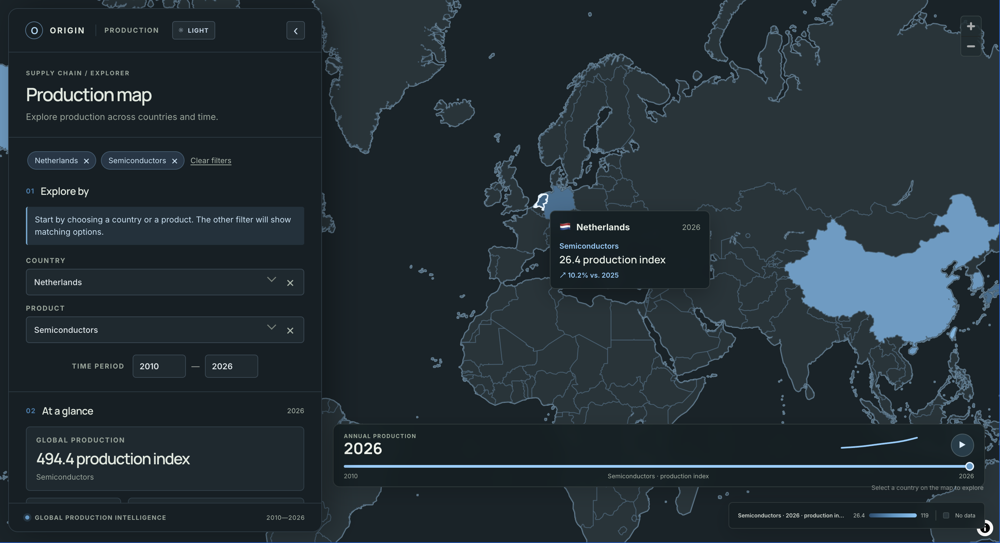

# Origin — Global Production Intelligence

A client-side React + TypeScript prototype for exploring illustrative production by country, product, and year. The interactive MapLibre choropleth uses the MapLibre demo style and its country vector tiles; no access token is required, but the style, tiles, and fonts need an internet connection. The basemap style is themed before MapLibre renders it, and the canvas stays hidden while loading to prevent the unstyled default map from flashing on first visit or reload.

The map fills the viewport, with searchable cascading filters, production summaries, and country details in a collapsible side panel. A year slider with playback animates annual production from 2010–2026; hover a country for its value and year-over-year change. The analytics panel includes market share, a production trend, and top-five rankings. The sidebar uses Google Fonts' Inter typeface, and the selected light/dark theme is saved in local storage.

## Prototype result



## Run locally

```sh
npm install
npm run dev
```

Run the test suite with:

```sh
npm test
```

Choose either a country or a product first; the other filter narrows to compatible choices. Filter values can be searched and cleared individually or together. The year range and country-level trend cover 2010–2026. Production values are generated locally for demonstration and are not real statistics.

Country/product combinations and their mock production profiles are defined in `src/features/production/model/production.ts`. Production values are local; the basemap and its country boundaries are served by MapLibre's demo tile service.

## Source structure

- `src/App.tsx` composes the page and contains the production summary; `src/app/` keeps application-level layout, theme, and responsive styles.
- `src/features/production/` owns country/product types, mock production data, and aggregation helpers.
- `src/features/explorer/` owns explorer state and derived view data.
- `src/features/map/`, `timeline/`, `filters/`, `country-spotlight/`, and `shell/` contain their UI features and styles; `src/features/summary/` contains summary styles.
- `src/styles/` contains global document styles.

Feature components receive typed data and callbacks from `App`; domain data and state derivation are kept separate from presentation.
